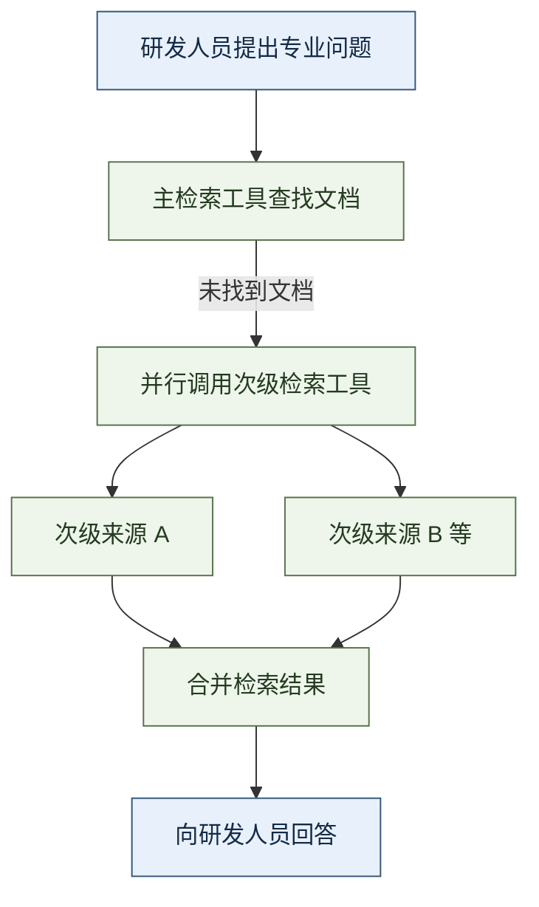

# 制造业知识 Agent：Toyota 怎样把设备经验与研发资料交到员工手中

GearPal 是 Toyota 北美面向产线技术员的维修知识 Agent：技术员用自然语言描述机器故障，它找出相关诊断信息、历史维修记录和维修指引，辅助现场排障。它属于 Toyota 企业 AI 团队建设的应用组合；同一篇案例还介绍了企业知识平台 ToyotaGPT 和研发检索助手 R&D GPT。

[LangChain 发布的客户案例][source]讨论的是这组应用怎样共同发展：一个约 35 人的团队，如何复用开发基础和领域知识，支持全公司的不同任务，再通过运行记录发现问题、决定下一步投入。理解这条主线，才能把 GearPal 的维修支持、R&D GPT 的研究支持和平台的开发提速放在各自的位置。

> 本文依据 Sofia Sulikowski 于 2026 年 8 月 24 日发表的客户案例。前六节解析原文，产品能力与效果数字均按案例及 Toyota 受访团队的自述呈现；第七节单独讨论证据边界与本站判断。

## 一、约 35 人的团队，为什么要建设共享平台

Toyota 企业 AI 团队同时承担两项工作：制定公司 AI 应用的技术标准，以及交付优先级最高的产品。它服务的范围包括制造、供应链、金融服务、经销商、车载开发和研发，团队成员则涵盖工程师、架构师、产品经理和内部推广人员。

需求覆盖面很广，而团队只有约 35 人。如果每做一个应用，都重新搭建模型调用、工具执行和运行监控，有限的人力就会不断消耗在共同基础上。AI 工程总监 Kordel France 在原文中回顾，他们曾尝试自行建设整套工具，付出了大量开发时间和人力。

业务回报也约束着技术选择。原文称，每个项目需要达到每年六至七位数美元的投资回报门槛。团队要交付能影响制造产出和效率的产品，因而转向复用 Deep Agents、LangGraph 和 LangSmith，而把更多工程时间留给具体应用。

这三个名称在案例中承担不同角色：

| 技术 | 在本文中的含义 | 原文介绍的用途 |
| --- | --- | --- |
| Deep Agents | 提供 Agent 通用运行能力的开发框架 | 作为新 Agent 的开发基础，在运行时接入可复用的领域 Skill |
| LangGraph | 用于组织执行步骤、分支和工具调用的编排框架 | 支撑共同开发基础，并用于 R&D GPT 的并行检索 |
| LangSmith | 用于记录和分析 Agent 运行过程的平台 | 追踪交互、排查工具与检索故障、观察员工采用情况 |

原文的逻辑是：通用能力集中维护，制造和研发等任务在其上分别实现。下面先看企业入口与知识复用，再看两个具体业务应用。

## 二、ToyotaGPT 怎样复用内部知识与开发能力

### 1、按业务领域提供 Agent，并保留原有数据权限

ToyotaGPT 是团队的内部旗舰平台，包含不断增加的领域 Agent。员工用它查询制造文档、研发报告和供应链记录等内部资料。

回答能否使用某份资料，受底层数据权限约束。原文给出的例子是 SharePoint：员工如果没有某个数据集的访问权，Agent 也不会向他展示该数据集中的内容。这是案例对平台访问原则的描述。

原文中的三个产品可按直接任务区分：

| 产品 | 谁使用 | 要解决的问题 | 提供的帮助 |
| --- | --- | --- | --- |
| ToyotaGPT | 各部门员工 | 公司资料分散在不同业务领域 | 通过领域 Agent 回答内部知识问题 |
| GearPal | 产线设备技术员 | 机器故障时需要迅速找到诊断依据和处理经验 | 汇集诊断信息、历史维修记录和维修指引 |
| R&D GPT | 研发人员 | 专业资料跨库分散，相关细节难以人工逐一查找 | 检索研发材料，综合相关内容支持研究 |

ToyotaGPT 说明共同平台怎样服务各部门；GearPal 和 R&D GPT 展示维修与研发场景中的具体价值。

### 2、把领域知识做成可跨应用使用的 Skill

团队将制造、供应链、研发和品牌等领域知识整理成 Skill。这里的 Skill 是供 Agent 使用的领域知识与工作说明，可以在运行时提供给模型。

原文强调的是知识的可复用性。制造知识如果只写在某个 Agent 的专有配置中，其他应用就难以直接使用；团队改为建设共享 Skill 库，让不同用例能够取得相应的组织知识。后文 GearPal 对设备经验的整理，就是这项做法在维修场景中的应用。

这让新应用可以同时复用两类资产：Deep Agents 等框架提供的运行基础，以及团队积累的领域知识。开发者不必为每项新需求重新建设整套基础能力。

### 3、新 Agent 的交付周期怎样变化

原文称，ToyotaGPT 已有超过 50 个 Agent 在生产环境运行。在建设当前开发基础之前，交付一个新 Agent 约需六名工程师工作六个月；采用当前基础后，约由一名工程师四天完成。

Agentic AI 与产品研究总监 Ravi Chandu Ummadisetti 将这种变化归因于现成的 Agent 运行框架与生态：创建新 Agent 时，团队已有可用的开发起点，可以集中处理业务需要的知识和能力。

这组数字回答的是“团队能否跟上全公司的应用需求”。GearPal 的诊断时间和 R&D GPT 的研究周期，回答的是应用进入业务之后产生什么效果，原文分别在两个案例中展开。

## 三、GearPal 怎样帮助产线技术员排障

### 1、把现场问题接到诊断资料和维修记录上

GearPal 面对的是非计划停机。原文强调，产线上不同位置的停机会带来很高的损失，并给出每分钟数十万至数百万美元的成本说法。作者以此说明，技术员更快取得排障信息具有直接的业务价值。

技术员走到有问题的机器前，可以直接询问“这台机器为什么坏了，应该怎样修”。GearPal 根据问题提供相关诊断信息、历史服务记录和维修指导。三类材料分别帮助技术员理解故障、参考过去的处理情况，以及查找可用的修复指引。

这段业务过程可以概括为：**技术员提出现场问题，GearPal 找出相关维修知识，技术员利用这些材料继续排障。** 自然语言入口让技术员从手头的故障出发查询，不必先知道资料存在哪个位置。

Toyota 团队称，过去可能需要五至六小时的诊断，现在两至三分钟即可得到结果。原文把这项变化放在减少停机的目标之下，强调的是故障发生后取得诊断帮助的速度。

### 2、用 Skill 保存设备经验，帮助新技术员接手

GearPal 还处理资深技术员退休带来的知识传承问题。新员工面对机器故障时，需要的不仅是某份文档，也包括组织长期积累的设备知识。

团队把这类知识整理进 Skill，使新老技术员都能借助 GearPal 调用相关经验。这样，已有经验可以通过共同的查询入口被使用，而不只依赖现场恰好有熟悉这台机器的人。

共享 Skill 库在这里有了具体用途：前一节讨论的是跨应用复用领域知识，这一节则是把设备知识提供给正在处理故障的技术员。

### 3、模型服务中断时，仍保留查询渠道

产线使用还要求服务持续可用。团队为 GearPal 增加了 LLM gateway，即集中接入模型服务、处理模型切换的网关。当某家模型供应商发生中断时，系统可以回退到备用模型服务。

这一做法处理的是查询服务的连续性。原文将它与自然语言诊断和知识传承放在一起，说明 GearPal 从可用的问答应用走向产线部署，还需要应对外部模型服务故障。

## 四、R&D GPT 怎样查找跨资料库的研发细节

### 1、车漆研发说明了资料为何难找

R&D GPT 面向研究人员，基于 Deep Agents 构建。Toyota 的研发材料专业性强，分散在几十个文档库里；研究人员需要从大量材料中找到与当前问题有关的细节。

原文用车漆举例。研发一种车漆涉及多年配方工作，还要经过高温与低温测试、耐腐蚀分析，以及机器人喷涂精度验证。一个看似单一的产品问题，实际横跨多类研究材料。

R&D GPT 让研究人员查询内部研发资料，找出过去可能需要数周人工阅读才能发现的细节。案例称，上线后，相关研究周期从约三年缩短到一年。这是原文对研发工作整体效果的报告，与某一次检索的响应耗时不同。

### 2、相邻领域的材料容易被混淆

检索难点不只是资料数量多，还包括领域重叠。车漆、腐蚀、座椅材料和皮革等资料之间存在关联，系统既要理解相关性，也要找准问题主要指向的资料来源。

团队早期遇到的具体问题是：研究人员问车漆，系统有时却错误地从腐蚀数据库取内容。车漆确实涉及耐腐蚀分析，但两类问题不能因此使用同一组材料回答。

原文随后介绍了团队建设的并行工具调用机制：当 Agent 在主检索工具中找不到文档时，通过 LangGraph 同时查询次级工具，再合并结果后回答。

### 3、主工具没有文档时，并行补查次级来源

下图只表示原文明确描述的补查路径。A、B 是为了说明并行关系而设置的来源代称，不代表 Toyota 公开了资料库名称或数量。

*图：根据原文 R&D GPT 一节整理的检索补查流程。*

这段过程包含三个相互衔接的动作：主工具先查找文档；没有找到时，将查询扩展到次级来源；多个查询结果合并后，再用于回答研究人员。并行发生在补查阶段，合并发生在回答之前。

这项机制属于 R&D GPT。GearPal 的原文描述集中在设备诊断、维修知识和模型故障切换，两项应用各自解决不同的业务问题。

## 五、LangSmith 怎样支持排错和产品决策

### 1、像产线安灯看板一样，查看应用哪里出了问题

原文将 LangSmith 比作 Toyota 的 Andon board，即安灯看板。产线用看板展示哪些地方正常运行、哪里出了故障、哪里需要支援；AI 团队借用这个比喻，说明他们也需要看见各个 Agent 的运行状态。

工程人员通过 LangSmith 追踪单次交互，查看工具调用失败、检索失败，以及哪些代码变更破坏了原有流程。这些记录让“回答不对”或“应用不能用”进一步对应到可调查的执行过程。

Kordel 还强调，运行过程的可观测性有助于团队向业务负责人解释系统行为，并建立对产品安全性的信心。原文因此把观测同时放在工程排错与获得业务支持两个场景中。

### 2、从部门使用情况决定接下来开发什么

团队也在 ToyotaGPT 平台层使用 LangSmith Insights Agent。这是用于分析 Agent 使用与交互情况的工具，帮助团队理解不同部门如何采用平台，并判断值得优先建设哪些专用 Agent。

这里关注的是应用需求：工程师从单次轨迹发现故障，平台团队从跨部门的使用情况寻找下一项产品机会。共同开发基础缩短交付时间，使用分析则帮助有限的团队决定把这段时间投入哪里。

## 六、原文报告了哪些效果，哪些仍是预测

原文分别报告开发交付、设备诊断与研发周期的变化，并以此讨论未来的财务价值。把这些数字按对象展开，才能看清每项数字说明什么。

| 对象 | 原文报告 | 数字描述的范围 |
| --- | --- | --- |
| 平台规模 | 超过 50 个生产 Agent | 已进入生产环境的应用数量 |
| 新 Agent 交付 | 六名工程师、六个月，缩短为一名工程师、四天 | 共同开发基础上的应用交付变化 |
| GearPal 诊断 | 五至六小时缩短到两至三分钟 | 设备诊断获得结果的时间 |
| R&D GPT 相关研究 | 约三年缩短到一年 | 案例所称的研究周期变化 |
| 制造用例收益 | 预计在产线、车间和工厂层面产生每年至少六位数美元节省 | 正在推进的收益预期 |
| 更大范围的收益 | 随应用组合成熟，预计单个设施每年节省数百万美元；未来几年期待七至八位数美元的节省规模 | 扩展应用后的预测和目标 |

财务部分使用的是“有望达到”“预计”和“期待”的表述。Kordel 希望未来能报告更大规模的节省；文章标题所强调的“进入资产负债表”，表达的是希望 AI 的效果最终反映到财务回报上。

原文收尾还回到一个更直接的结果：四天的 Agent 交付周期，让团队能够跟上企业内部不断出现的需求。平台规模扩大、业务应用产生效果、财务收益逐步兑现，是作者连接全文的论证顺序。

## 七、本站判断：如何理解效果，怎样借鉴做法

### 1、三种提速需要三种验收口径

这篇材料是 LangChain 发布、引用 Toyota 团队访谈的客户案例。它足以说明客户如何描述产品与收益，没有提供可独立复算的项目样本、统计方法或对照数据。上述效果应保留为客户自述。

“一名工程师四天”描述的是已有平台上的新 Agent 交付，不能据此估算从零建设企业数据接入、权限体系和知识库的总工期。GearPal 的两三分钟描述诊断结果，不能直接换算成维修完成时间或停机缩短比例。R&D GPT 的三年到一年也没有按研究阶段展开，不能据此认定每项实验、测试和验证都等比例提速。

原文未给出停机成本的核算依据、车型与产线条件，也没有公开未来节省金额的完整计算过程。六位数、数百万和七至八位数分别出现在不同范围与时间预期中，不宜相加，也不应当作已经兑现的财务结果。

### 2、已披露的检索策略，还不足以还原生产控制流

按[本目录对执行控制的判断口径](../index.md#四架构方式与执行控制)，GearPal 可以描述为**使用企业 Agent 平台的检索与诊断应用，完整控制流尚未披露**。原文没有提供 GearPal 的生产源码或完整调用轨迹，无法确认模型如何继续调查、何时换工具，以及按什么条件结束。

R&D GPT 披露了“主工具未找到文档后并行补查”的路径，但没有说明主工具怎样选定、怎样判定检索结果适用、多个来源冲突时怎样处理。尤其是原文提到的“问车漆却取到腐蚀材料”，属于取到了不合适的内容；“没有找到文档”则是另一种情况。仅凭补查流程，还不能还原团队如何完整解决检索精度问题。

ToyotaGPT 的 SharePoint 权限例子说明了平台的访问原则，不能替代对 GearPal 每个数据接入点的权限核验。模型网关处理供应商故障，LangSmith 提供运行记录，两者也都不能独立证明维修建议正确或权限实现完备。

### 3、适合复用哪些做法，落地时要补什么

**有多个内部知识应用时，可以借鉴共享开发基础和领域 Skill 库。** 制造与研发团队可以共用运行能力，同时分别维护设备知识和研究资料的使用说明。但 Skill 中的知识仍需要明确负责人、适用设备或领域、版本与更新方式；原文没有展开这些维护流程。

**资料分散且有领域交叉时，可以借鉴按条件扩展检索。** 在复制 R&D GPT 的做法前，应先用真实问题检查主来源能否选对，再分别测试“没有找到材料”和“找到但不适用”的处理方式。次级检索还需验收资料版本、实验条件与冲突结果，不能只统计检索返回了多少内容。

**设备维修应用宜从辅助诊断开始验收。** 可以固定设备型号、故障代码、维修手册版本和答案引用记录，让技术员核对，并分别记录取得诊断、完成检修和恢复生产的时间。原文没有描述维修工单、备件调度或复产批准，也没有展示 GearPal 自主执行维修；据此直接设计自动维修闭环，依据仍不充分。

运行观测则应服务这些具体验收问题。例如，记录一次设备问题使用了哪些资料、在哪次调用失败、技术员是否采纳，以及最终是否解决故障，才能把检索质量、现场效果与收益核算逐步连接起来。

---

原文：[How Toyota North America Put Enterprise AI on the Balance Sheet with Deep Agents and LangSmith][source]，Sofia Sulikowski，2026-08-24。本文按原文的团队背景、ToyotaGPT、GearPal、R&D GPT、LangSmith 与收益展望六部分复核；复核日期：2026-10-08。

[source]: https://www.langchain.com/blog/how-toyota-north-america-put-enterprise-ai-on-the-balance-sheet-with-deep-agents-and-langsmith
