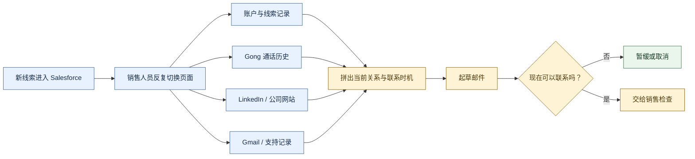
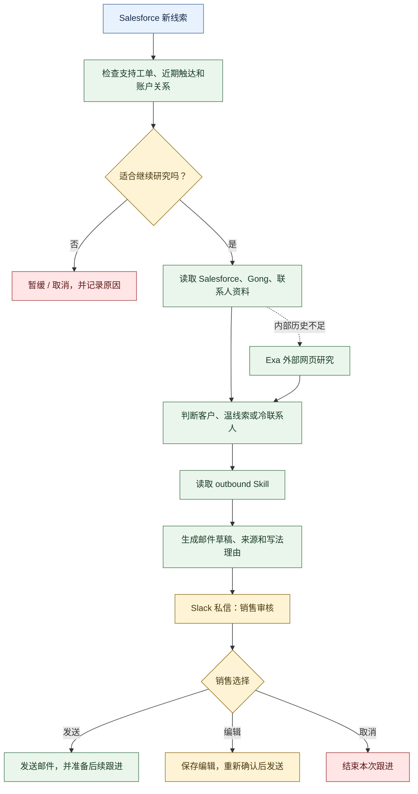
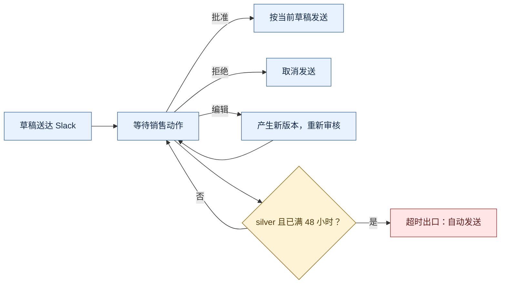
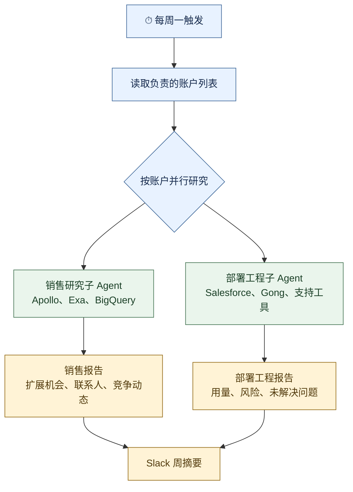
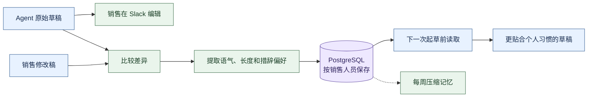
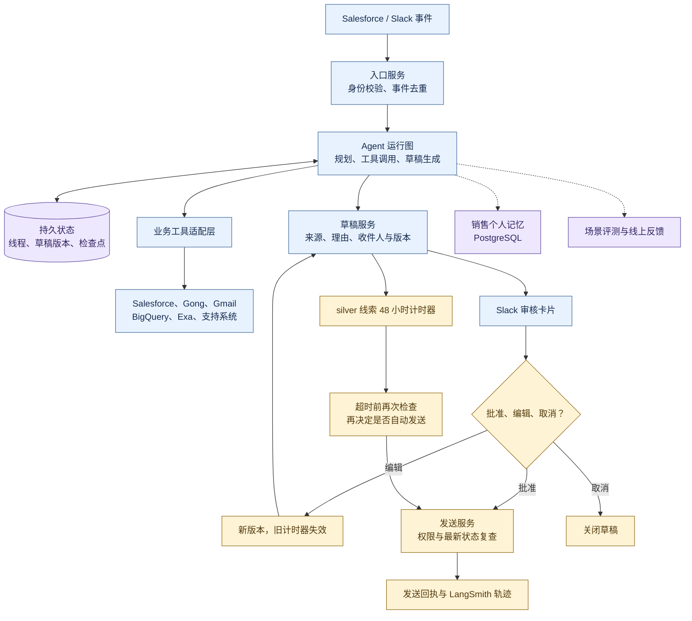

# 销售跟进 Agent：从线索研究、邮件审核到账户经营

> 来源：LangChain 团队的[工程文章](https://www.langchain.com/blog/how-we-built-langchains-gtm-agent)，发布于 2026 年 3 月 9 日。下文先讲清原文案例，再单列本站的工程判断；文中的 Mermaid 图根据原文正文整理，不是 LangChain 公布的生产架构图。

LangChain 的 GTM（Go-to-Market，面向客户开展获客与销售）Agent 服务内部销售、客户经理和部署工程师。它从 Salesforce 新线索触发，调查账户和联系人，起草带来源与理由的邮件，交给销售在 Slack 审核；它还每周整理账户情报，帮助团队发现扩展机会和客户健康风险。

原文真正要解决的是销售工作的衔接问题：资料分散在多个系统，人工研究一个线索就要来回切换页面；邮件发送又不能只追求速度，因为同事可能刚联系过客户，或者客户刚提交了支持工单。文章还披露了一个需要特别区分的例外：silver 线索在草稿发出 48 小时后无人批准或拒绝时，会自动发送。

## 一、先看销售为什么会漏跟进：资料分散、关系判断和发送风险同时存在

**本节说明 Agent 出现前，销售人员到底被什么工作拖住，以及团队在写第一行邮件之前设定了哪些边界。**

### 1、一个线索要先拼出完整关系，再决定是否值得联系

原文描述的人工路径很具体：销售先看 Salesforce 账户记录，再去 Gong 找通话历史，打开 LinkedIn 了解联系人，最后读公司网站。调查可能持续约十五分钟，而且销售不容易知道同事是否在前一天已经联系过这个账户。

这不只是“搜索资料太慢”。每个来源回答的问题不同：

| 来源 | 销售要确认的事实 | 事实缺失时的风险 |
| --- | --- | --- |
| Salesforce | 账户关系、线索来源、负责人与历史记录 | 把已有客户当成陌生联系人 |
| Gong | 过去的会议、承诺和未解决问题 | 重复询问或错过上下文 |
| LinkedIn 与公司网站 | 联系人职责、公司近期方向 | 写出与客户现状无关的内容 |
| Gmail、支持记录 | 最近邮件、支持工单和团队触达 | 在不合适的时间继续催促 |

**图 1：原来的人工工作怎样被多个系统切碎。** 线索本身不是邮件正文，销售必须先把多个事实来源拼成一个“当前关系”。

### 2、团队要自动化研究和起草，但把对外发送控制在人手里

团队在写代码前先定义了成功标准：减少销售研究和起草时间，提高营销线索转成合格商机的比例。对应的约束有三条：

- 联系前必须查是否刚出现支持工单，或团队是否已经触达；
- 现有客户、温线索和冷联系人采用不同的写法；
- 草稿要带关键资料和写法理由，销售能看懂 Agent 为什么这样写并进行编辑。

原文把“明确人工审核后才发送”列为不可妥协的原则。这个原则解释了为什么系统的第一版出口是 Slack 审核，而不是 Agent 直接调用 Gmail。

### 3、两类任务共享资料入口，但交付给不同的人

GTM Agent 后来承担两条任务：

| 任务 | 触发方式 | 交付内容 | 决策人 |
| --- | --- | --- | --- |
| 新线索跟进 | Salesforce 出现新线索 | 经过研究的邮件草稿、来源和理由 | 负责销售 |
| 账户情报 | 每周一的定时任务 | 扩展机会、竞争动态或客户健康信号 | 销售与部署工程师 |

两条任务都需要查客户关系和产品使用，但输出目标不同。新线索流程关心“现在是否该联系、怎样联系”；账户情报关心“本周哪些账户值得投入时间、哪里需要人员介入”。

## 二、再看新线索怎样被 Agent 处理：先排除不宜联系，再研究、起草和审核

**本节沿一条线索从进入 Salesforce 到邮件出口的路径，说明 Agent 怎样把人工研究变成可追踪的长流程。**

### 1、第一步不是写信，而是寻找不该发送的信号

新线索出现后，Agent 先检查支持工单、近期外联和账户关系。如果客户刚提交问题，或同事本周已经联系过，系统应停止或暂缓，而不是因为“有新线索”就自动发信。

通过检查后，Agent 才读取完整 Salesforce 记录、Gong 通话和联系人资料。内部历史不足时，再通过 Exa 做外部网页研究，了解公司正在做什么，尤其是它是否有新的 AI 方向。

### 2、关系类型决定写法，Skill 给出可复用的销售工作手册

Agent 在起草前加载 outbound skill。这里的 Skill 是一份按需读取的销售工作手册，规定不同关系状态下应该怎样联系：

- **现有客户**：从已知合作和当前使用情况切入；
- **温线索**：利用已有会议、同事联系或共同背景；
- **冷联系人**：缩短内容，只使用有依据的公司和个人信息。

邮件草稿、关键来源和写法理由随后发到销售的 Slack 私信。销售可以发送、编辑或取消；选择发送后，Agent 还会准备一组后续跟进邮件，由销售决定是否加入跟进序列。

**图 2：新线索处理的完整路径。** 虚线表示“资料不足时才做外部研究”，橙色节点表示仍由业务规则或销售决定的出口。

Deep Agents 在这里解决了两个工程问题。第一，通话记录和网页研究的长度不稳定，大型工具结果可以放进虚拟文件系统，模型上下文里只保留需要继续工作的引用。第二，原文使用规划清单固定“排除不宜发送 → 研究 → 起草 → 说明理由 → 准备跟进”的基本顺序，便于排错和评测。

### 3、48 小时超时是业务例外，不是模型自己判断可以发送

团队后来为 silver 线索增加了 48 小时服务时限：草稿送达后，销售在这段时间内没有批准也没有拒绝，系统就自动发送。原文称，这提高了原本容易无人跟进的线索的响应率。

这条规则和前文的“明确审核后发送”存在张力，必须分别记录：前者是系统最初的安全原则，后者是后来针对 silver 线索增加的业务例外。原文没有披露超时任务的生产代码，也没有说明倒计时绑定草稿版本后是否会在发送前重新检查支持工单、近期外联和退订状态。

## 三、账户情报怎样把“每周看 50 到 100 个账户”变成两类报告

**本节说明 Agent 怎样从单个线索扩展到账户经营，并解释为什么销售和部署工程师需要不同的输出。**

### 1、每周一汇总账户变化，销售看机会，部署工程师看风险

随着团队扩大，销售每人负责的账户从 50 个增加到 100 个以上。人工逐个查看产品使用、招聘、融资、产品发布和近期通话，很容易错过扩展机会或服务风险。

Agent 每周一读取 Salesforce 和 BigQuery，再查询外部网页信息，形成两种报告：

| 接收者 | 报告关注什么 | 希望推动的动作 |
| --- | --- | --- |
| 销售 | 产品使用、软件包安装量、AI 工程师招聘、高管变化、融资和产品动态 | 找出扩展机会，确定值得联系的人 |
| 部署工程师 | 产品用量、近期客户通话、未解决问题、续约日期、额度消耗 | 判断哪里需要人员介入 |

**图 3：同一批账户资料怎样分成两条业务视图。** 每个账户的研究可以独立执行，主 Agent 最后再汇总成周报。

### 2、子 Agent 的价值在于隔离工具和并行账户任务

账户研究由编译后的子 Agent 执行。销售研究子 Agent 只能使用 Apollo、Exa 和 BigQuery，部署工程子 Agent 使用 Salesforce、Gong 和支持工具；两者按约定的结构返回结果，主 Agent 负责跨账户组织报告。

这种委派解决的是规模问题：一个账户的通话和网页资料不会挤满所有账户共享的上下文，每个账户也可以独立运行。LangSmith Deployment 提供持久执行和横向扩展的运行基础。它没有把所有业务判断都交给一个模型，而是用受限工具集合和结构化输出约束子任务。

### 3、账户报告仍然是给人安排工作的情报，不是自动改动客户关系

原文介绍了扩展机会、竞争动态和客户健康信号，但没有说 Agent 会自动联系客户、修改账户负责人或改变服务配置。报告的作用是把“值得人看哪里”提前整理出来，后续触达和介入仍由销售或部署工程师推进。

## 四、编辑、评测和真实使用怎样让系统逐步变好

**本节说明 Agent 的质量闭环由什么组成：销售编辑提供个人写作反馈，场景评测拦截回归，线上动作检验这些改动是否真的有用。**

### 1、销售编辑被抽成个人写作记忆

销售修改 Slack 草稿后，系统比较原稿和修改稿。若差异足够明显，模型抽取结构化的风格观察：改了什么、反映了什么偏好，以及可选的示例。观察结果按销售人员写入 PostgreSQL，下一次起草前读取；每周定时任务压缩记忆，避免历史编辑无限增长。

这里的记忆只表达某个销售的写作偏好，不能替代每次运行都要重新查的联系资格、支持工单和近期触达。稳定地出现在多个销售编辑中的规律，才适合进一步沉淀为公共写作规则。

### 2、评测把“写得像不像”与“流程有没有做对”分开

团队先建立少量真实场景，再加入更难的案例，例如专业术语密集的行业、已有 Gong 通话记录的账户、需要重新联系的老客户。测试环境模拟外部 API，让流程可以在接触真实数据前运行。

评测分两层：

- **规则检查**：工具是否选对、顺序是否合理、是否重复生成草稿；
- **模型评审**：语气、字数和格式是否合适。

两层检查都进入持续集成。线上每次发送、编辑和取消都挂到 LangSmith 轨迹，团队再观察写法与打开、回复之间的关系，只有跨多个销售反复出现的规律，才会进入公共默认行为。

### 3、原文报告的结果要按自述口径阅读

原文报告了以下结果，时间范围是 2025 年 12 月至 2026 年 3 月：

| 指标 | 原文自述结果 | 阅读边界 |
| --- | --- | --- |
| 线索转合格商机率 | 上升 250% | 文中未提供同条件对照设计 |
| 销售管道金额 | 达到三倍 | 不能单独归因于 Agent 或 48 小时规则 |
| 低意向线索跟进 | 上升 97% | 反映跟进行为变化 |
| 高意向线索跟进 | 上升 18% | 反映跟进行为变化 |
| 销售时间 | 每人每月节省约 40 小时，全团队约 1,320 小时 | 团队报告值 |
| 使用情况 | 日活 50%，周活 86% | 反映内部采用情况 |

这些数字说明团队认为系统产生了业务价值，但不足以单独证明某个组件带来的增量。尤其不能把个人风格记忆、账户子 Agent 和 silver 超时规则混成一个效果来源。

### 4、后台 Agent 后来变成全公司的 Slack 入口

系统最初是 ambient agent（后台触发的 Agent）：Salesforce 出现线索后，后台运行，草稿直接到销售 Slack。后来团队增加了可直接提问的 Slack 入口，工程师用它查产品使用，客户成功人员在续约前查支持历史，客户经理在会议前汇总 Gong 通话。

原文的解释很直接：这些用户并不是团队一开始专门设计的目标，而是因为 Agent 已经连接了 Salesforce、Gong、BigQuery 和 Gmail，员工发现通过对话查询比打开多个页面更方便。

## 五、最终工程总结：用 Agent 组织研究，用业务状态机控制对外动作

**本节把整个案例收束成可落地的实现方案：从事件入口、数据工具和 Agent 状态，到 Slack 审核、48 小时定时器、记忆、评测和运行观测，说明哪些部分交给模型，哪些部分必须由程序负责。以下是本站工程建议，不是 LangChain 公开的生产源码。**

### 1、建议的总架构：研究可以开放，发送必须有明确状态和凭证

这类系统适合采用 **Agent 主导研究与起草，业务流程控制发送与超时** 的混合架构。模型可以决定需要查哪些资料、如何组织证据、采用什么联系角度；程序应控制触发去重、审核状态、计时器、版本、权限和发送结果。

### 2、先把状态和业务对象定义清楚，再接 Agent

至少需要保存以下对象；具体字段可按业务调整：

| 对象 | 核心字段 | 作用 |
| --- | --- | --- |
| LeadRun | lead_id、account_id、触发事件 ID、当前状态 | 防止同一线索重复启动多个运行 |
| Draft | 草稿 ID、版本号、收件人、正文、来源、理由、Skill 版本 | 让销售审核的是一份可回查的具体内容 |
| Approval | 动作、审批人、批准的草稿版本、时间 | 证明谁批准了哪一版草稿 |
| Timer | 草稿版本、到期时间、取消状态 | 让编辑、拒绝和新触达能使旧计时器失效 |
| SendReceipt | 邮件 ID、发送请求 ID、结果、错误和轨迹 ID | 证明是否真的发送成功，便于重试和排错 |

推荐的状态转换是：

received → checking → researching → draft_ready → awaiting_review → approved / edited / declined / expired → sent

expired 只允许 silver 线索进入，且不能等同于“销售批准”。如果业务不能接受沉默发送，超时出口应改成提醒负责人或转交经理。

### 3、48 小时计时器要绑定草稿版本，执行前必须重新检查

一个可复查的超时实现至少要满足以下条件：

1. 创建草稿时记录 draft_version、due_at 和 lead_tier；
2. 销售编辑、取消或重新生成草稿时，让旧计时器失效；
3. 计时器到期后，先检查当前草稿版本仍未批准或拒绝；
4. 再查支持工单、近期团队触达、退订状态、收件人和账户归属；
5. 通过检查后，以稳定的 send_request_id 调用发送服务，并记录回执；
6. 任何状态竞争都以数据库条件更新或版本号校验为准，不能依赖模型记住“不要重复发送”。

模型可以提出“这个线索适合继续联系”，但不应拥有绕过这些检查的发送权限。超时任务属于业务调度与状态管理，Agent 的研究结论只是一项输入。

### 4、Skill、工具和子 Agent 分别承担不同责任

- **Skill**：说明现有客户、温线索和冷联系人的研究重点、写作风格和必查事项；它是可版本化的工作手册。
- **工具**：读取 Salesforce、Gong、BigQuery 等真实系统，并返回带来源和时间的结构化结果；写入 Gmail 前应重新做权限与状态检查。
- **子 Agent**：在账户情报任务中隔离销售研究和部署工程研究，限制工具集合，返回固定结构；只有账户数量和上下文规模值得并行时才引入。
- **Agent 运行图**：组织当前任务、加载 Skill、调用工具和生成草稿；它不替代业务状态机。
- **LangSmith 轨迹与评测**：记录工具顺序、发送/编辑/取消动作和模型输出，支持规则检查、模型评审与回归分析。

这种拆分让“需要判断的部分”和“必须确定的部分”各自有合适的实现：Agent 判断应该研究什么、怎样表达；程序保证查到了什么、批准了哪一版、是否真的发出去了。

### 5、按一条最小链路实施，再逐步扩大范围

落地时可以按下面的顺序推进：

| 阶段 | 先实现什么 | 通过标准 |
| --- | --- | --- |
| 1 | Salesforce 触发、账户查询和重复事件去重 | 一条线索只生成一个可追踪运行 |
| 2 | Gong、联系人和支持记录研究 | 每个结论能回到来源和时间 |
| 3 | Skill 起草与 Slack 审核 | 销售能查看、编辑、取消和批准具体版本 |
| 4 | LangSmith 轨迹、规则评测和模型评审 | 工具顺序、重复草稿和格式回归可发现 |
| 5 | PostgreSQL 个人写作记忆 | 编辑能改善后续写法，且不影响联系资格检查 |
| 6 | silver 48 小时超时 | 旧版本失效、到期重查、发送结果可确认 |
| 7 | 每周账户情报和并行子 Agent | 销售与部署工程师收到各自需要的报告 |

第一条链路跑通后，再加入更多业务系统和账户级任务。评测场景应覆盖刚出现支持工单、同事已触达、草稿被编辑后超时、收件人退订、重复事件、发送请求超时和多个账户并行等情况。

### 6、案例的适用边界：可以复用分工，不能照搬收益和自动发送

这个案例适合需要跨系统研究、输出需要解释、且任务会随关系状态变化的销售或客户经营场景。可以借鉴它的资料汇总、关系感知写作、个人编辑记忆、账户级并行研究和从第一天开始做评测的做法。

固定模板就能完成的通知不需要 Agent；没有稳定客户主数据、联系人授权和发送回执时，也不适合直接自动发信。原文没有公开 silver 等级的判定条件、超时服务端代码、发送前复查细节或完整生产架构，因此这些部分必须按自己的业务规则和风险承受能力重新设计。

从架构到工程实现，这个案例最后要落成一条能回查的链路：**线索事件 → 关系研究 → 带证据的草稿 → 具体版本的审核 → 受规则控制的发送 → 可核验回执 → 编辑与评测反馈**。Agent 负责把资料和任务组织起来，系统状态、业务权限和对外动作则需要由确定性的服务守住边界。

资料：[LangChain GTM Agent 原文](https://www.langchain.com/blog/how-we-built-langchains-gtm-agent)。正文与配图复核日期：2026-10-07。

