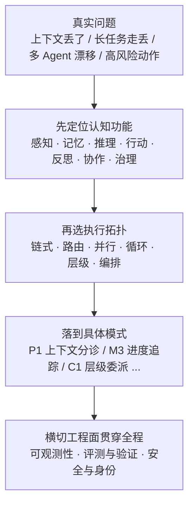

# Agent 设计模式之美（ADPS）

- 模式白皮书：[https://adpsagent.com/zh/patterns/](https://adpsagent.com/zh/patterns/)
- 案例蓝皮书：[https://adpsagent.com/zh/cases/](https://adpsagent.com/zh/cases/)
- 极客时间专栏：[https://time.geekbang.org/column/intro/101162601](https://time.geekbang.org/column/intro/101162601)
- 项目仓库：[https://github.com/huangjia2019/agent-design-patterns](https://github.com/huangjia2019/agent-design-patterns)
- 论文：[A Two-Dimensional Framework for AI Agent Design Patterns（arXiv:2605.13850）](https://arxiv.org/abs/2605.13850)

## 这条资源主要在讲什么

《Agent 设计模式之美》是黄佳在极客时间开的专栏，主题是“沉淀 ADPS 通用范式，做可成长的 Agent 系统”。黄佳是新加坡 A*STAR AI 研究员、Manning《Designing AI Agents》作者，也是 ADPS（Agent Design Patterns Society）的发起人之一。专栏和 ADPS 白皮书共用同一套双轴框架：专栏按七个模块系统讲，白皮书和站点负责公开定义、案例与持续更新。

它最特别的地方不是又列了一批模式，而是先给出一张坐标系：

- **认知功能**回答 Agent 在做什么：感知、记忆、推理、行动、反思、协作、治理。
- **执行拓扑**回答 runtime 怎么组织这些功能：链式、路由、并行、循环、层级、编排。
- 每个矩阵模式必须落到两条轴的交点上。这样你不仅知道“有哪些模式”，还要回答“为什么这个模式在这个位置、我的问题落在哪”。

